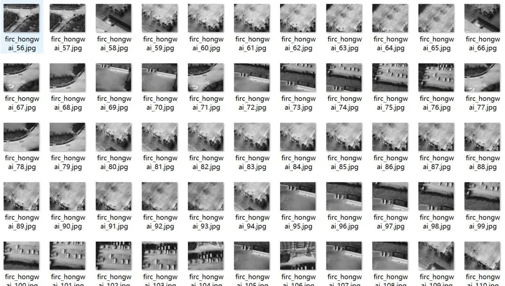
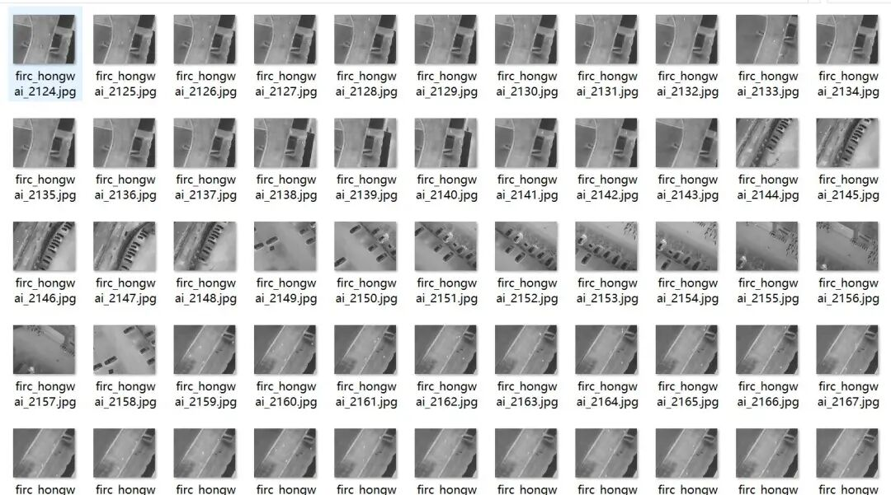
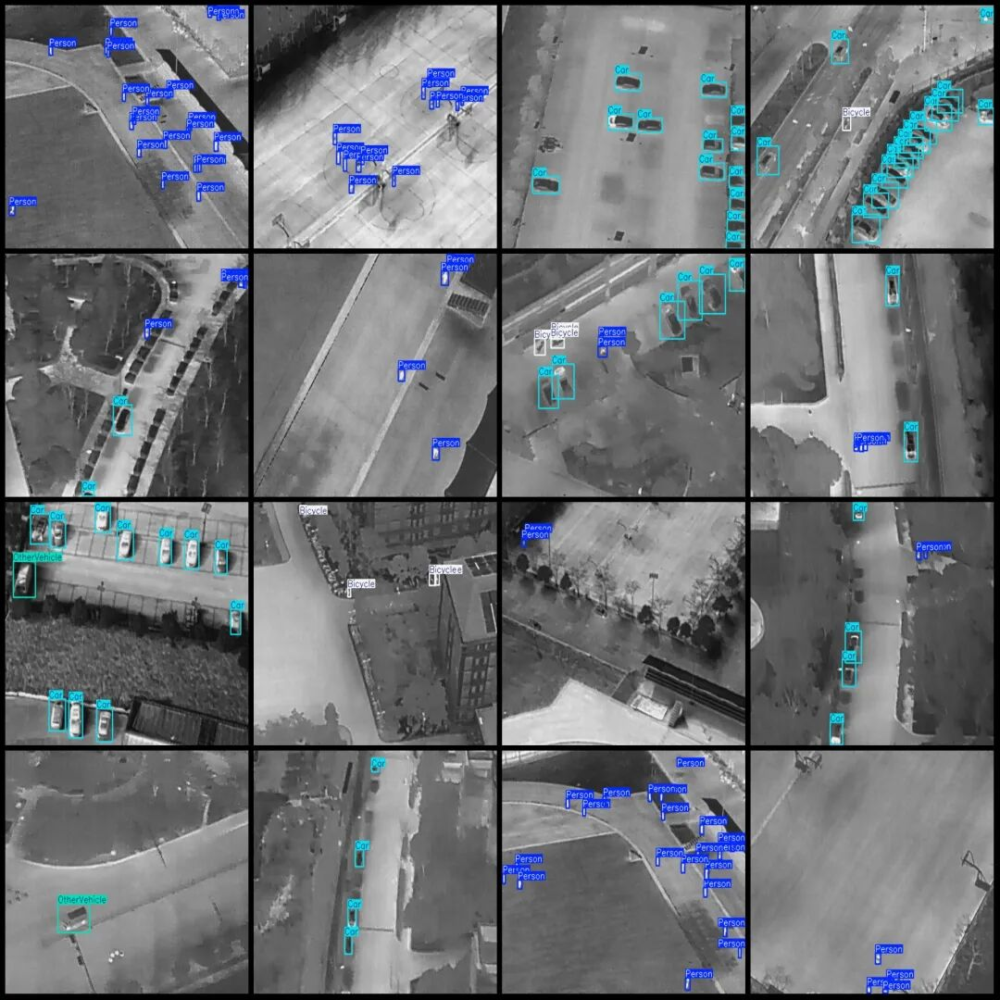

# UAV High-Altitude Infrared Thermal Image Human and Vehicle Detection Dataset VOC+YOLO format with 2866 images in 4 categories

Dataset format: Pascal VOC format + YOLO format (txt file without split path, only containing jpg images and corresponding VOC format xml files and yolo format txt files)

Number of images (number of jpg files): 2866

Number of annotations (number of xml files): 2866

Number of annotations (number of txt files): 2866

Labeling category count: 4

Label category names (note that the order of yolo format categories does not correspond to this, but is based on the classes.txt in the labels folder): ["Bicycle", "Car", "OtherVehicle", "Person"]

Number of boxes labeled in each category:

Bicycle Frame Count = 4980

Car frame count = 7311

OtherVehicle Frame Count = 148

Person Frames = 12312

Total frame count: 24751

Using labelImg:

Annotation rules: Draw a rectangle around the category.

Image resolution: 640x512

Important Notice: No

Special : This dataset does not guarantee the accuracy of the trained models or weight files.

Image Preview:

Annotation example:

## Payment

Here is a pay link on Stripe ( https://buy.stripe.com/3cs8yP7sY87d0vu9AB ). Please contact me lonlonago@foxmail.com after funding $89, and I will send you a complete data files , thank you!

